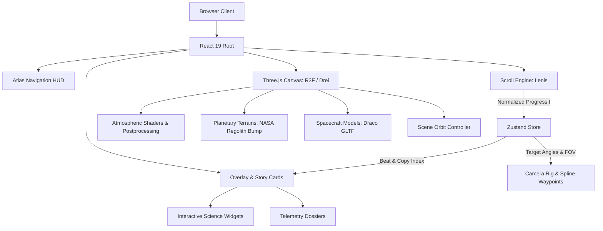

# 🌌 ABANDONED, BUT NOT FORGOTTEN
### *The Atlas of Quiet Explorers*

[](https://www.spaceappschallenge.org/)
[](https://react.dev/)
[](https://threejs.org/)
[](https://vitejs.dev/)
[](https://www.typescriptlang.org/)
[](https://tailwindcss.com/)

> **"They are not debris. They are the most patient scientific archive ever deployed across the solar system."**

---

## 🔭 Mission Overview

**Abandoned, But Not Forgotten** transforms historical deep-space hardware into an accessible, museum-grade scientific documentary and interactive 3D atlas. 

Around eight planets, dozens of moons, and interplanetary orbits, human-made machines sit in celestial stillness. This web experience reveals the real engineering, exact planetary coordinates, causal scientific discoveries, and present states of humanity's quiet robotic ambassadors.

Designed for educators, students, space researchers, and general audiences, the application balances cinematic 3D visual fidelity with accessible, non-WebGL fallback reading modes.

---

## 🛰️ Core Experience Modes

The experience operates in two primary synchronized modalities:

```
┌────────────────────────────────────────────────────────────────────────┐
│                   THE ATLAS OF QUIET EXPLORERS                         │
├───────────────────────────────────┬────────────────────────────────────┤
│   ▶ GUIDED STORY MODE (CINEMA)    │   ↓ SCROLL & ATLAS EXPLORER        │
├───────────────────────────────────┼────────────────────────────────────┤
│ • Automated camera choreography   │ • Normalized scroll progress [0,1] │
│ • Word-count calculated holds     │ • Interactive 3D scene orbiting    │
│ • Real-time speed switch (1x-2x)  │ • Collapsible scientific widgets   │
│ • Gentle touch/scroll pause       │ • Planetary surface maps & globes  │
└───────────────────────────────────┴────────────────────────────────────┘
```

### 1. Autonomous Guided Story Mode
- **Zero-Friction Playback**: Launches with a single click from the permanent HUD header or opening hero.
- **Dynamic Pacing Engine**: Calculated reading pauses per scene allow visitors to absorb the science and view the hardware without rushing.
- **Full Player HUD**: Play, pause, skip forward/backward, playback speed modifier (`1×` to `2×`), and time countdown indicators.
- **Smart User Interruption**: Natural mouse wheel, touch scroll, or key navigation gently suspends the tour without competing for camera control.

### 2. Scroll-to-Explore Atlas Mode
- **Inertial Smooth Scrolling**: Powered by Lenis, synchronizing scroll depth to camera spline waypoints, FOV, lighting angles, and narrative reveals.
- **Interactive 3D Orbit (`SceneOrbit`)**: Click-and-drag or touch-swipe directly on any 3D scene to inspect spacecraft and landing sites from any angle.
- **Full Keyboard Accessibility**: Arrow keys rotate the viewpoint, `+`/`-` zoom into the hardware, and `Home` resets the camera.

### 3. Accessible Reading Mode (No-WebGL & Reduced Motion)
- **Zero-3D Static Atlas**: Automatic fallback for low-spec devices, screen readers, and visitors with `prefers-reduced-motion`.
- **WCAG AAA Compliance**: Semantic HTML structure, high-contrast dark glass typography, and screen-reader aria live regions.

---

## 🪐 The 5-Beat Scientific Pattern

Every featured artifact follows an educational visual storytelling structure:

1. **World**: A labeled, textured celestial body establishing solar system context.
2. **Place**: An authentic surface location with verified selenographic/areocentric coordinates.
3. **Machine**: High-detail NASA 3D model with realistic PBR materials, gold foil MLI insulation, and procedural fallbacks.
4. **Discovery**: Direct causal link explaining **How It Worked → What It Taught Us**.
5. **Afterward**: Honest historical accounting of its final transmission, impact, or permanent resting status.

---

## 🛸 The 15 Featured Quiet Explorers

| # | Spacecraft / Artifact | World & Location | Status | Primary Discovery |
|---|----------------------|------------------|--------|-------------------|
| **01** | **Apollo 11 LM (*Eagle*)** | Moon · Mare Tranquillitatis | Descent stage stationary (1969) | First human lunar touchdown, regolith bearing capacity |
| **02** | **Surveyor 3 & Apollo 12** | Moon · Oceanus Procellarum | Stationary landmark (1967/1969) | Long-term space environment exposure analysis |
| **03** | **Apollo 15 LRV (*Rover 1*)** | Moon · Hadley-Apennine | Parked at site (1971) | 27.8 km surface geology traverse; Genesis Rock retrieval |
| **04** | **Apollo ALSEP Array** | Moon · Central Science Stations | Retired passive arrays (1977) | Confirmed deep moonquakes and internal lunar crust structure |
| **05** | **Viking 1 Lander** | Mars · Chryse Planitia | Final signal 1982 (6.25 years) | First continuous meteorological log & surface inorganic chemistry |
| **06** | **Mars Pathfinder & Sojourner** | Mars · Ares Vallis | Final signal 1997 | First autonomous rover traverse; ancient catastrophic flood deposits |
| **07** | **Opportunity Rover (*MER-B*)** | Mars · Meridiani Planum | Lost in 2018 global dust storm | Discovered hematite "blueberries" proving ancient standing liquid water |
| **08** | **InSight Lander** | Mars · Elysium Planitia | Dust-covered solar arrays (2022) | SEIS seismometer mapped Martian core, mantle thickness, and marsquakes |
| **09** | **Ingenuity Mars Helicopter** | Mars · Jezero Crater | Rotor blade damaged; flight 72 (2024) | First powered aerodynamic flight in extraterrestrial atmosphere (0.01 atm) |
| **10** | **Dawn Spacecraft** | Asteroid Belt · Ceres & Vesta | Frozen in stable Ceres orbit | Discovered hydrated salts in Occator Crater & layered protoplanet crust |
| **11** | **NEAR Shoemaker** | Asteroid 433 Eros · Surface | Landed 2001; signal ceased | First soft landing on an asteroid; revealed asteroid density and composition |
| **12** | **Pioneer 10** | Outer Solar System · Interstellar Cruise | Last carrier signal 2003 | First Jupiter flyby, asteroid belt transit, carries Golden Plaque |
| **13** | **Kepler Space Telescope** | Heliocentric Earth-Trailing Orbit | Fuel exhausted 2018 | High-precision transit photometry; discovered 2,600+ confirmed exoplanets |
| **14** | **Apollo 16 & 17 S-IVB Stages** | Moon · Impact Craters | Intentional seismic impacts | Calibrated artificial seismic sources for internal lunar seismology |
| **15** | **Mars Science Laboratory Descent Stage** | Mars · Gale Crater | Impacted surface at safe distance | Sky Crane rocket architecture enabling 900 kg Curiosity rover landing |

---

## 🛠️ Interactive Scientific Widgets

Every story scene includes purpose-built interactive engineering modules:

- **Moonquake Waveform**: Visualizes real Apollo seismometer recordings from lunar impacts.
- **Footpad Scale**: Compares human bootprint depth to Apollo 11's 0.9m dished footpad in regolith.
- **Surveyor Distance Ruler**: Demonstrates Apollo 12's pinpoint 180-meter precision landing next to Surveyor 3.
- **Dust Storm Slider**: Simulates the progressive atmospheric optical depth ($\tau$) that ended Opportunity's mission.
- **InSight Vital Signs & Audio**: Plays acoustic recordings of Martian wind measured by SEIS sensors.
- **Flight Counter & Descent Ladder**: Tracks Ingenuity's 72 operational flights against its 5-flight experimental goal.
- **Interplanetary Signal Delay**: Live calculator of the two-way radio latency from Pioneer 10 and Kepler to Earth.
- **Transit Photometry Demo**: Interactive exoplanet transit light-curve simulator based on Kepler data.
- **Interactive 3D Model Explorer**: Dedicated model sandbox to examine Draco-compressed NASA spacecraft models.

---

## 🏗️ Architecture & Technology Stack



- **Frontend Core**: React 19, TypeScript, Vite 8.
- **3D Graphics & Shaders**: Three.js r187, React Three Fiber (R3F), `@react-three/drei`, `@react-three/postprocessing`.
- **Styling & HUD Design**: Tailwind CSS 4, glassmorphism, Inter & Manrope variable typography.
- **State & Scroll Management**: Zustand reactive stores, Lenis smooth scrolling.
- **3D Assets & Textures**: Draco-compressed NASA 3D Resources, NASA Scientific Visualization Studio (SVS) planetary textures (LROC Moon, Mars MOLA, Blue Marble Earth, USGS Venus radar).

---

## ⚡ Quickstart & Local Development

### Prerequisites
- **Node.js**: `v22.0.0` or higher
- **npm**: `v10.0.0` or higher

### Installation & Launch

```bash
# 1. Clone repository
git clone https://github.com/1pruthvik/Mnasa.git
cd Mnasa

# 2. Install dependencies cleanly
npm ci

# 3. Start local development server with network host
npm run dev -- --host 127.0.0.1
```

Open your browser at **`http://127.0.0.1:5173/`**.

### Production Build & Verification

```bash
# Compile and build production bundle
npm run build

# Run static linting audit
npm run lint

# Verify science and archive data integrity
npm run check-data

# Verify storytelling copy and vocabulary rules
npm run check-copy

# Verify story sequence and shot continuity
npm run check-story

# Audit guided demo playback pacing (2-minute calibration)
npm run check-playback
```

---

## 🏛️ Verification, Accuracy & Sources

All narrative facts, mission timelines, hardware specifications, and coordinates are checked against primary scientific and space agency archives:
- **NASA Planetary Data System (PDS)**: [pds.nasa.gov](https://pds.nasa.gov/)
- **NASA Space Science Data Coordinated Archive (NSSDCA)**: [nssdca.gsfc.nasa.gov](https://nssdca.gsfc.nasa.gov/)
- **NASA Scientific Visualization Studio (SVS)**: [svs.gsfc.nasa.gov](https://svs.gsfc.nasa.gov/)
- **NASA 3D Resources**: [nasa3d.arc.nasa.gov](https://nasa3d.arc.nasa.gov/)
- **JPL Solar System Exploration**: [solarsystem.nasa.gov](https://solarsystem.nasa.gov/)

Detailed model and image attributions are maintained in [`public/models/ATTRIBUTION.md`](public/models/ATTRIBUTION.md) and [`public/images/ATTRIBUTION.md`](public/images/ATTRIBUTION.md).

---

## 📜 Ethical Framing & Non-Endorsement

- **Preservation vs. Debris**: This project intentionally refrains from pejorative terminology (*junk, graveyard, trash*). These machines are treated as permanent historical monuments and passive scientific laboratories.
- **Honest Attribution**: 3D spacecraft and terrains are clearly identified as scientific illustrations and schematic models, not real-time live telemetry.
- **Non-Endorsement Notice**: *This is an independent educational web application built for the NASA Space Apps Challenge 2026. It is not an official NASA website and is not endorsed by or affiliated with the National Aeronautics and Space Administration.*

---

**Built with pride for NASA Space Apps Challenge 2026.**
